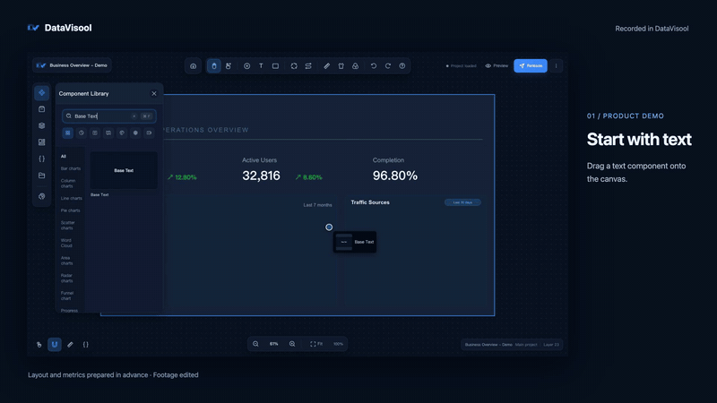

<div align="center">
  

  <h1>DataVisool Web</h1>

  <p><strong>Bring data, visuals, and interactions together.</strong></p>
  <p>A browser-based designer for dashboards and data visualizations.</p>
  <p>React · TypeScript · Spring Boot · MySQL</p>
  <p><a href="README_CN.md">简体中文</a> &nbsp; | &nbsp; English</p>

  <p>
    <a href="#features">Features</a> &nbsp;·&nbsp;
    <a href="#getting-started">Getting Started</a> &nbsp;·&nbsp;
    <a href="#migrate-from-lcp">Migrate from LCP</a> &nbsp;·&nbsp;
    <a href="#run-from-source">Run from Source</a> &nbsp;·&nbsp;
    <a href="#documentation">Documentation</a> &nbsp;·&nbsp;
    <a href="#license">License</a>
  </p>
</div>

---

DataVisool Web brings canvas editing, data configuration, and visual interaction design into the browser. Combine charts and other components to build, preview, and publish visualizations.

## Product Demo

[](docs/media/videos/datavisool-demo-en-1080p.mp4)

<p align="center"><sub>Building a dashboard in DataVisool with sample data. <a href="docs/media/videos/datavisool-demo-en-1080p.mp4">Open the full video</a>.</sub></p>

<details>
<summary>Play the full video in supported Markdown viewers</summary>

<video controls preload="none" width="960" poster="docs/media/videos/datavisool-demo-en.png">
  <source src="docs/media/videos/datavisool-demo-en-1080p.mp4" type="video/mp4">
  <a href="docs/media/videos/datavisool-demo-en-1080p.mp4">Open the English demo video</a>
</video>

</details>

## Features

| | |
| --- | --- |
| **Visual canvas**<br>Add charts, text, images, video, maps, and 3D models; adjust their layout and appearance. | **Data connections**<br>Configure static data, APIs, databases, WebSocket, and MQTT sources. |
| **Blueprint interactions**<br>Connect component events and actions to build interactive behavior. | **AI assistance**<br>Configure a model and use AI-driven features in the designer. |
| **Custom components**<br>Build server components with the component development tools and upload them for use in the designer. | **Project management**<br>Preview and publish projects, manage access settings, and import or export project packages. |

## Getting Started

### Access DataVisool

Open a deployed DataVisool Web instance in your browser and sign in with an account provided by its administrator. To deploy a service, see the [Web deployment guide](docs/zh-cn/deploy/web.md) (in Chinese).

### Create Your First Project

1. Create a project from the console or project list.
2. Drag components onto the canvas and adjust their layout.
3. Configure static data or connect a data source.
4. Optionally, use the blueprint editor to connect events and actions.
5. Save, preview, and publish your project.

The [quick start](docs/zh-cn/quick_start/quick_start.md) includes screenshots and detailed steps (in Chinese).

## Migrate from LCP

The current Web importer can attempt supported LCP project ZIPs with a legacy manifest, as well as no-manifest ZIPs containing exactly one valid `.lc` project data file. Real samples of manifest version 1 and no-manifest packages have not been verified; compatibility cannot be determined from the LCP application version alone.

Old application directories, databases, and standalone `.lc` files cannot be imported as project ZIPs; unknown formats, unsupported encryption, and damaged packages also fail. Even supported packages can contain components that cannot be converted, missing assets, or data sources that need reconfiguration. Import success does not guarantee identical visuals or interactions.

Back up the original, import into an empty DataVisool Web project, and check the visuals, assets, data, and interactions. For package identification, unsupported cases, and remedies, see the **[LCP migration guide](docs/migration-lcp-en.md)**.

## Run from Source

Install Node.js, pnpm, JDK 17, Maven, and MySQL. Set up a local or isolated database and configure its connection in `datavisool-server/datavisool-service/src/main/resources/application-dev.yml` before starting the server. Set `DB_PASSWORD` in the environment; for a new database also set `DATAVISOOL_ADMIN_PASSWORD` to the initial `admin` password (at least 8 characters and at most 72 UTF-8 bytes). Remove the latter after initialization. Existing databases retain their administrator password. The default development profile enables database checks and migrations.

From the repository root:

```bash
# Install frontend dependencies
pnpm install

# Install the shared backend module and start the service
cd datavisool-server
mvn -pl datavisool-common -am install -DskipTests
mvn -f datavisool-service/pom.xml spring-boot:run
```

In a second terminal at the repository root:

```bash
pnpm -F datavisool-app dev
```

Open the address printed by Vite. The frontend development server proxies `/api/**` and `/static/**` to `http://127.0.0.1:8080` by default; login and project storage require the backend and database. For configuration, builds, and tests, see [source development](docs/zh-cn/start.md) (in Chinese).

## Project Structure

| Directory | Contents |
| --- | --- |
| [`datavisool-app`](datavisool-app/) | React application, dashboard designer, and frontend tests |
| [`datavisool-server`](datavisool-server/) | Spring Boot service, APIs, and resource handling |
| [`docs/zh-cn`](docs/zh-cn/) | Chinese user guide, deployment, and development documentation |
| [`script/build`](script/build/) | Scripts for building Web deployment packages |

## Documentation

- [User Guide](docs/zh-cn/README.md) — product features and common tasks (Chinese)
- [Quick Start](docs/zh-cn/quick_start/quick_start.md) — create and publish a dashboard (Chinese)
- [Migrating from LCP](docs/migration-lcp-en.md) — package support, boundaries, and remedies
- [Legacy Package Compatibility](datavisool-doc/旧项目包导入兼容清单.md) — supported conversions and limitations (Chinese)
- [Web Deployment](docs/zh-cn/deploy/web.md) — Java and Docker deployment options (Chinese)
- [Source Development](docs/zh-cn/start.md) — local setup and builds (Chinese)
- [Custom Component Development](docs/zh-cn/develop/index.md) — component development and upload (Chinese)

## Feedback and Contributions

Use the repository hosting platform's issue tracker to report problems or suggest improvements. Before submitting changes, read the project license and run the checks relevant to your changes.

## License

This project uses the [DataVisool License](LICENSE). Personal use, teaching and research, nonprofit activities, and an organization's own internal business use are permitted free of charge. Providing or distributing the software to third parties, client projects, and other specified commercial uses require prior written authorization. Organizations must retain the DataVisool branding during internal use.

**The current license is not an open-source license as defined by the OSI.** Please read the full license and applicable third-party licenses before using, modifying, or sharing the software.
