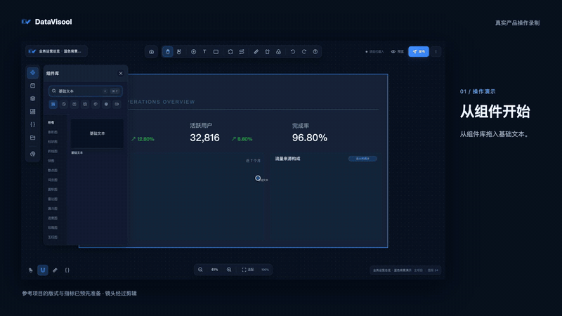

<div align="center">
  

  <h1>DataVisool Web</h1>

  <p><strong>把数据、画面与交互，组合成你的可视化作品。</strong></p>
  <p>一个在浏览器中搭建数据大屏与可视化看板的设计器。</p>
  <p>React · TypeScript · Spring Boot · MySQL</p>
  <p>简体中文 &nbsp; | &nbsp; <a href="README.md">English</a></p>

  <p>
    <a href="#功能概览">功能概览</a> &nbsp;·&nbsp;
    <a href="#开始使用">开始使用</a> &nbsp;·&nbsp;
    <a href="#从-lcp-迁移">从 LCP 迁移</a> &nbsp;·&nbsp;
    <a href="#从源码运行">从源码运行</a> &nbsp;·&nbsp;
    <a href="#文档">文档</a> &nbsp;·&nbsp;
    <a href="#许可证">许可证</a>
  </p>
</div>

---

DataVisool Web 将画布编辑、数据配置和蓝图交互带到浏览器中。通过组合图表和其他组件，你可以搭建、预览并发布自己的可视化项目。

## 产品演示

[](docs/media/videos/datavisool-demo-zh-1080p.mp4)

<p align="center"><sub>使用示例数据，在 DataVisool 中搭建看板。<a href="docs/media/videos/datavisool-demo-zh-1080p.mp4">打开完整视频</a>。</sub></p>

<details>
<summary>在支持的 Markdown 阅读器中播放完整视频</summary>

<video controls preload="none" width="960" poster="docs/media/videos/datavisool-demo-zh.png">
  <source src="docs/media/videos/datavisool-demo-zh-1080p.mp4" type="video/mp4">
  <a href="docs/media/videos/datavisool-demo-zh-1080p.mp4">打开中文版演示视频</a>
</video>

</details>

## 功能概览

| | |
| --- | --- |
| **可视化画布**<br>添加图表、文本、图片、视频、地图和 3D 模型，调整布局与样式。 | **数据接入**<br>配置静态数据、API、数据库、WebSocket 和 MQTT 等数据来源。 |
| **蓝图交互**<br>连接组件事件与动作，编排页面交互。 | **AI 辅助**<br>配置模型，在设计器中使用 AI 驱动能力。 |
| **扩展组件**<br>使用组件开发工具构建服务器组件，上传后在设计器中使用。 | **项目管理**<br>预览和发布项目、管理访问设置，以及导入或导出项目包。 |

## 开始使用

### 访问 DataVisool

在浏览器中打开已部署的 DataVisool Web 站点，使用管理员提供的账号登录。部署服务请参考 [Web 部署指南](docs/zh-cn/deploy/web.md)。

### 创建第一个项目

1. 在控制台或项目列表中新建项目。
2. 从组件库拖入组件，在画布上调整布局。
3. 配置静态数据或连接数据源。
4. 按需使用蓝图，连接组件事件与动作。
5. 保存、预览并发布项目。

带截图的操作步骤见 [快速开始](docs/zh-cn/quick_start/quick_start.md)。

## 从 LCP 迁移

当前 Web 版保留了 LCP 项目 ZIP 的导入能力：可尝试导入符合条件的旧清单包，以及 ZIP 内只有一个有效 `.lc` 项目数据文件的无清单旧包。版本 1 清单和无清单包尚缺真实样本验证；不能仅凭 LCP 软件版本判断兼容性。

旧软件目录、数据库和单独的 `.lc` 文件不能作为项目 ZIP 直接导入；未知格式、不支持的加密方式和损坏的包也无法导入。支持的包仍可能遇到旧组件转换失败、资源缺失或数据源需要重新配置，导入成功不代表画面与交互完全一致。

请先备份原项目，在 DataVisool Web 的空项目中尝试导入，再逐项检查画面、资源、数据和交互。包格式判断、不支持的情况和处理方法见 **[LCP 项目迁移指南](docs/migration-lcp.md)**。

## 从源码运行

准备 Node.js、pnpm、JDK 17、Maven 和 MySQL。启动后端前，准备本地或隔离数据库，在 `datavisool-server/datavisool-service/src/main/resources/application-dev.yml` 中配置连接，并设置环境变量 `DB_PASSWORD`。全新数据库还需设置 `DATAVISOOL_ADMIN_PASSWORD` 作为 `admin` 初始密码（至少 8 个字符且不超过 72 个 UTF-8 字节）；初始化完成后可移除该变量，已有数据库的管理员密码不会被重置。默认开发配置会执行数据库检查和迁移。

在仓库根目录执行：

```bash
# 安装前端依赖
pnpm install

# 安装后端公共模块并启动服务
cd datavisool-server
mvn -pl datavisool-common -am install -DskipTests
mvn -f datavisool-service/pom.xml spring-boot:run
```

在仓库根目录另开终端：

```bash
pnpm -F datavisool-app dev
```

使用 Vite 输出的地址打开浏览器。前端开发服务器默认将 `/api/**` 和 `/static/**` 代理到 `http://127.0.0.1:8080`；登录和项目保存需要后端与数据库。配置、构建与检查说明见 [源码开发启动](docs/zh-cn/start.md)。

## 项目结构

| 目录 | 内容 |
| --- | --- |
| [`datavisool-app`](datavisool-app/) | React 应用、可视化设计器和前端测试 |
| [`datavisool-server`](datavisool-server/) | Spring Boot 服务、接口与资源管理 |
| [`docs/zh-cn`](docs/zh-cn/) | 中文使用、部署和开发文档 |
| [`script/build`](script/build/) | Web 发布包构建脚本 |

## 文档

- [使用指南](docs/zh-cn/README.md) — 产品功能与常用任务
- [快速开始](docs/zh-cn/quick_start/quick_start.md) — 创建并发布看板
- [从 LCP 迁移项目](docs/migration-lcp.md) — 项目包支持范围、边界情况与处理方法
- [旧项目包导入兼容清单](datavisool-doc/旧项目包导入兼容清单.md) — 旧项目转换范围与限制
- [Web 部署](docs/zh-cn/deploy/web.md) — Java 和 Docker 部署方式
- [源码开发启动](docs/zh-cn/start.md) — 本地配置和构建
- [组件开发](docs/zh-cn/develop/index.md) — 开发和上传服务器组件

## 反馈与参与

欢迎通过项目托管平台的议题功能反馈问题或提出建议。提交修改前，请阅读项目许可证，并根据改动范围运行相应检查。

## 许可证

本项目使用 [DataVisool License](LICENSE)。个人使用、教育机构教学与研究、非营利活动及组织内部业务使用免费。向第三方提供或分发软件、为客户制作项目等指定商业用途需事先取得书面授权；组织内部使用须保留 DataVisool 品牌标识。

**当前许可证不属于 OSI 定义的开源许可证。** 使用、修改或分享前，请阅读完整许可证及相关第三方许可。
