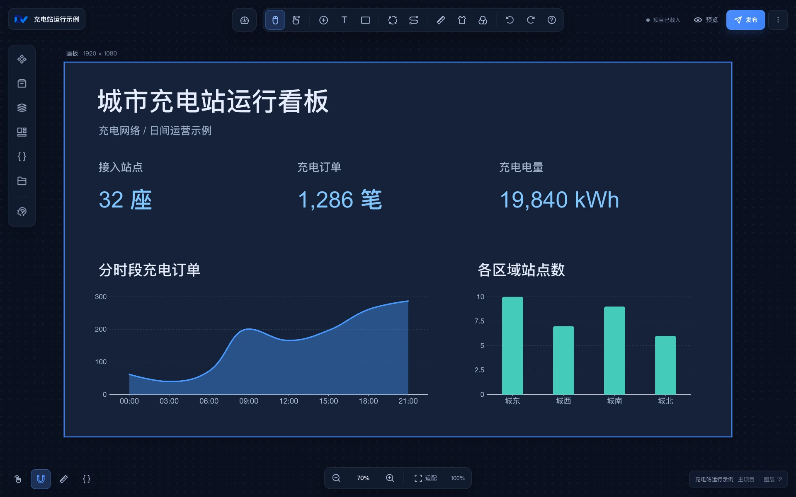

# DataVisool Web 使用指南

在浏览器里把图表拖到画布上，接入数据，再把看板发布为可访问的页面。第一次使用，可以跟着[快速开始](quick_start/quick_start.md)完成第一个项目。

## 开始使用

- **准备账号**　向站点管理员获取访问地址、用户名和密码。
- **制作看板**　从控制台新建项目，进入设计器添加组件。先用静态数据调好图表，再连接业务数据源。
- **分享结果**　预览效果后发布项目，在控制台的「发布管理」中查看访问地址。

## 按任务查阅

- [产品介绍](/introduce.md)
- [功能介绍](/functions/functions.md)
- [组件开发](/develop/index.md)
- [软件部署](/deploy/main.md)
- [Web 端部署](/deploy/web.md)
- [源码开发启动](/start.md)

[升级已有站点](/upgrade/upgrade.md) · [排查常见问题](/question/question.md)

## 实机演示

### 共享充电数据看板

[观看共享充电数据看板演示](https://www.bilibili.com/video/BV1Cr421j7Xs/)

### 机场动态数据看板

[观看机场动态数据看板演示](https://www.bilibili.com/video/BV1NE421j7ai/)

