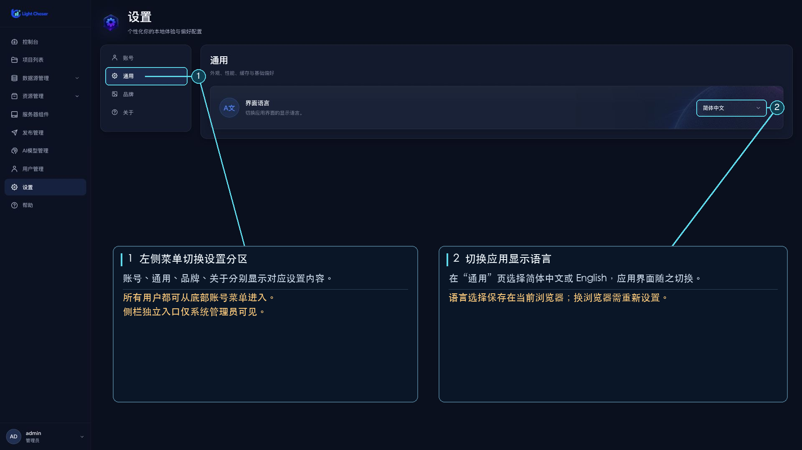

# 设置

设置页包含账号、通用、品牌和关于四个区域。登录用户可以从侧栏底部的账号菜单进入；只有系统管理员（`SYSTEM_ADMIN`）会在侧栏看到单独的“设置”入口。

> **配图说明：** 操作配图取自 2026-10 版 Web 手册。

## 账号

查看当前账号信息，并编辑页面显示名、电话、邮箱或密码。页面显示名字段标为“用户名”，修改后会同步到侧栏；它不会更改用于登录的用户名。

## 通用

“界面语言”可切换简体中文和 English。

## 品牌

系统管理员可保存管理中心主图和登录页 LOGO。页面分别建议使用 320 × 120 px 和 80 × 80 px 图片；选择图片后即可上传。

## 关于

查看版本号，或点击“报告问题”前往 GitHub Issues 提交问题。
