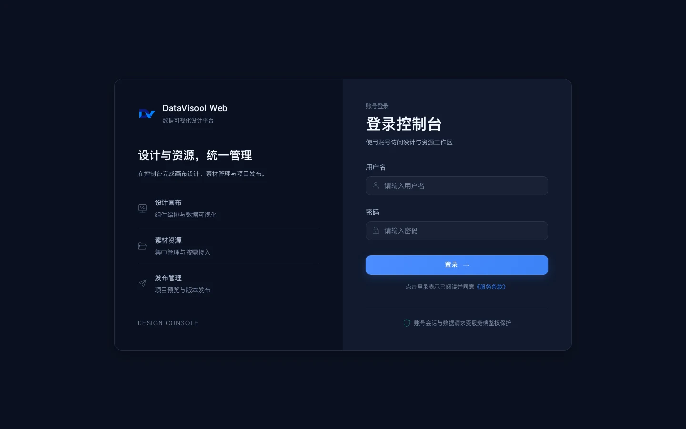
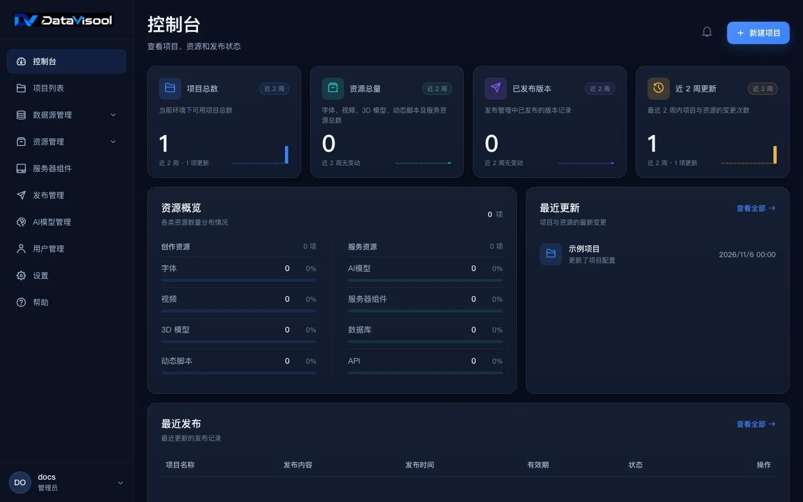
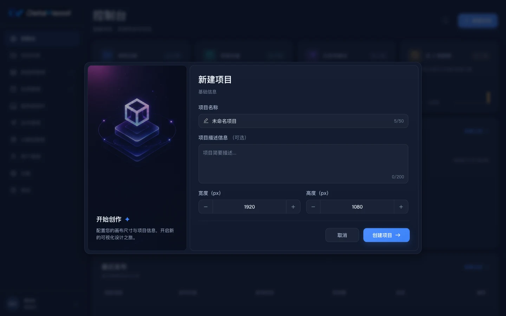
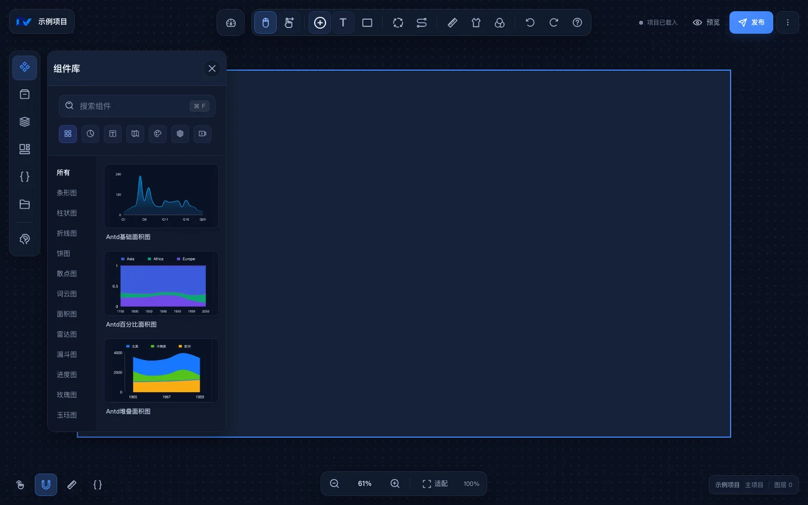
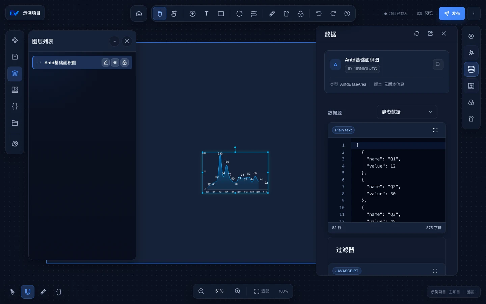
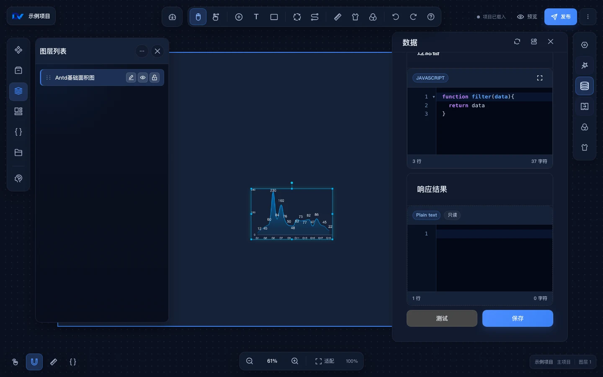
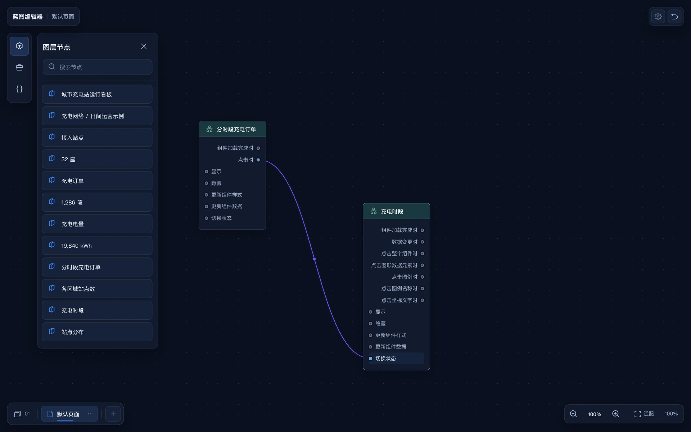
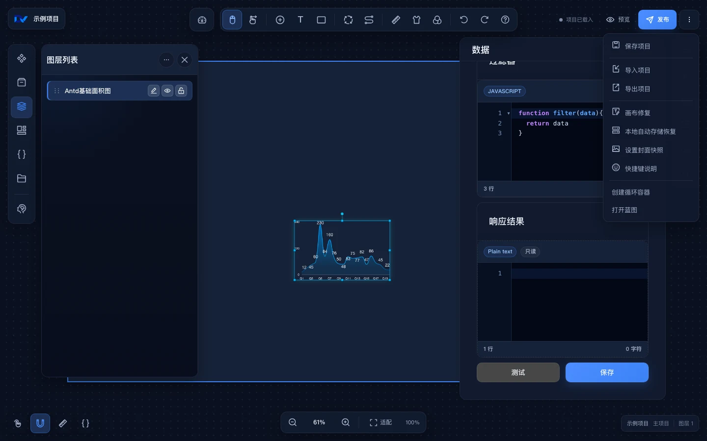
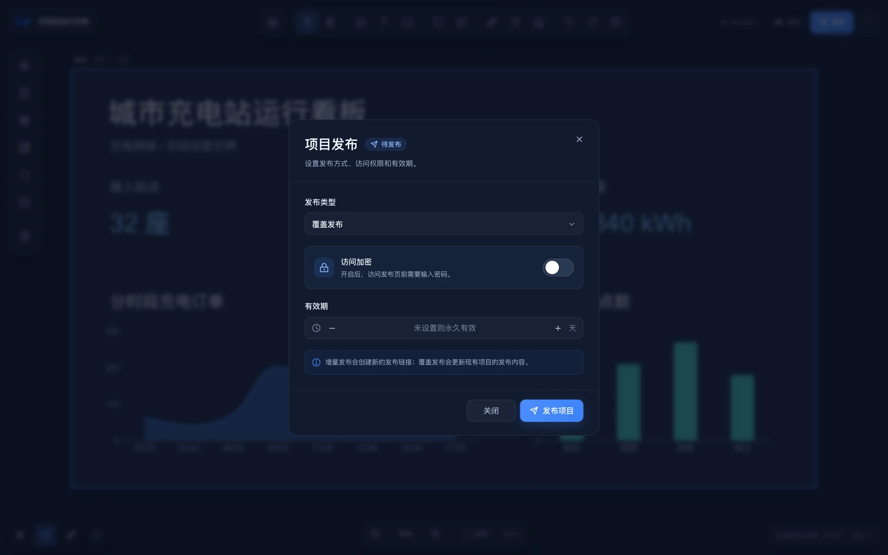

# 快速开始

用一张图表走完创建、配置、预览和发布的流程。开始前，请向管理员获取站点地址和账号。以下截图使用示例项目。

## 1. 登录

在浏览器打开站点地址，输入用户名和密码，然后选择“登录”。登录成功后会进入控制台。

## 2. 创建项目

在控制台右上角选择“新建项目”，也可以先打开左侧“项目列表”，再创建项目。

填写项目名称。项目描述为可选项，最多 200 个字符。画布宽度和高度默认分别为 1920 px 和 1080 px，均可调整，最小值为 300 px。完成后选择“创建项目”，进入设计器。

## 3. 添加组件并配置数据

在设计器左侧打开“组件库”，按分类浏览或搜索组件，再将组件拖到画布上的目标位置并松开。选中组件后，可在右侧“基础”配置中调整尺寸和位置。

选中组件后，打开右侧“数据”，在“数据源”中选择“静态数据”，编辑 JSON 并选择“测试”。检查“响应结果”后选择“保存”，应用这次配置。

滚动数据配置面板可查看过滤器及“测试”“保存”操作。

接入业务数据时，可按场景选择接口（API）、公共 API、数据库、WebSocket 或 MQTT。公共 API 和数据库需要先在控制台的“数据源管理”中配置。

[查看数据源管理说明](/functions/home/datasource_management.md)

## 4. 配置组件联动（可选）

在设计器右上角打开“更多项目操作”，选择“打开蓝图”。将两个组件的图层节点拖到蓝图画布，把第一个节点的事件输出连到第二个节点的动作输入。

[查看蓝图使用流程](/functions/blue_print/use_flow.md)

AI 辅助编辑需要管理员先配置可用模型。

[查看 AI 驱动说明](/functions/main_desiner/ai_fusion.md)

## 5. 保存、预览和发布

在设计器右上角打开“更多项目操作”，选择“保存项目”。

选择“预览”可查看页面效果。确认内容后，选择“发布”，按需设置发布方式、访问权限和有效期。

发布记录可在控制台的“发布管理”中查看。

[查看发布说明](/functions/main_desiner/publish/publish.md)

部署 Web 服务的步骤见 [Web 部署指南](/deploy/web.md)。
